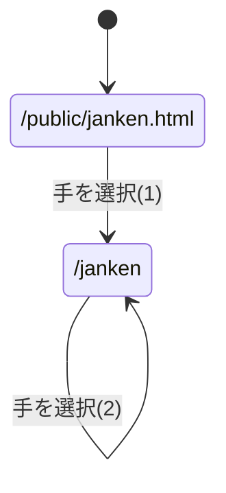
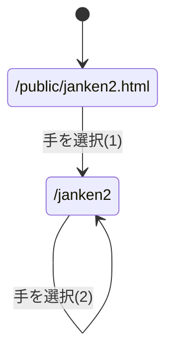

# webpro_06のページ遷移図

### じゃんけん関係
#### ページ遷移図

#### (1)のパラメータ

パラメータ名 | 属性 | 内容 | 値
-|-|-|-
hand | text | ユーザの手 | グー/チョキ/パー
win | hidden | 勝利数 | 0
total | hidden | 対戦数 | 0

#### (2)のパラメータ

パラメータ名 | 属性 | 内容 | 値
-|-|-|-
hand | text | ユーザの手 | グー/チョキ/パー
win | hidden | 勝利数 | これまでの勝利数
total | hidden | 対戦数 | これまでの対戦数

### じゃんけん関係（ラジオボタン版）
#### ページ遷移図

#### (1)のパラメータ

パラメータ名 | 属性 | 内容 | 値
-|-|-|-
hand | radio | ユーザの手 | グー/チョキ/パー
win | hidden | 勝利数 | 0
total | hidden | 対戦数 | 0

#### (2)のパラメータ

パラメータ名 | 属性 | 内容 | 値
-|-|-|-
hand | radio | ユーザの手 | グー/チョキ/パー
win | hidden | 勝利数 | これまでの勝利数
total | hidden | 対戦数 | これまでの対戦数

## input要素のtype，name，idの働き

- type：入力欄の種類を決める．textは文字を入力する欄，radioは選択肢から1つを選ぶボタン，hiddenは画面に表示されない欄になる．
- name：サーバに送るときのパラメータ名になる．janken2ではname="hand"なので，/janken2?hand=グー のように送られ，サーバ側ではreq.query.handで受け取る．ラジオボタンはnameが同じものが1つのグループになり，その中から1つだけ選べる．
- id：ページの中でその要素を1つに決めるための名前である．labelのforに同じ値を書くと，ラベルの文字をクリックしてもボタンを選べるようになる．idはサーバには送られない．

## htmlファイルとejsファイルの使い分け

- html：いつも同じ内容を表示するページに使う．publicフォルダに置き，サーバはファイルをそのまま返す．janken2.htmlやkeiyo2_new.htmlのような，最初に表示する入力フォームがこれにあたる．
- ejs：その時によって表示する内容が変わるページに使う．viewsフォルダに置き，プログラムで計算した値やデータをres.renderで渡してHTMLを作ってから返す．じゃんけんの結果を表示するjanken2.ejsや，駅の一覧を表示するkeiyo2.ejsがこれにあたる．
- つまり，中身が変わらないページはhtml，プログラムの結果を表示するページはejsを使う．

